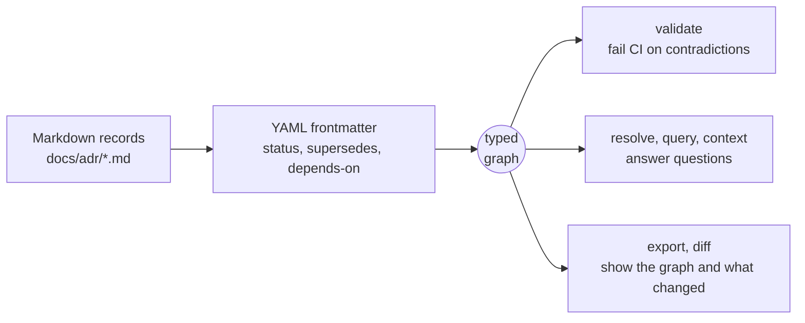
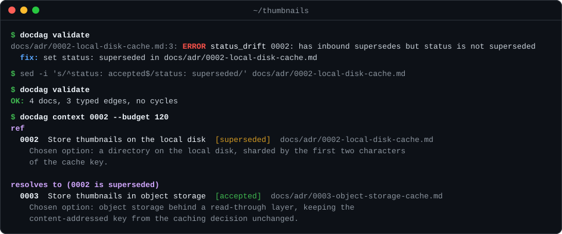
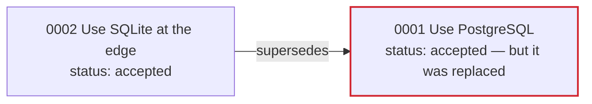
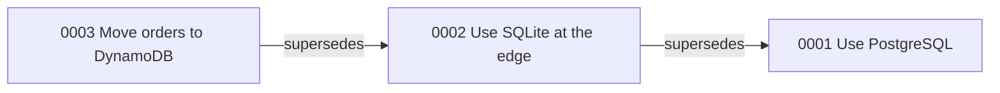
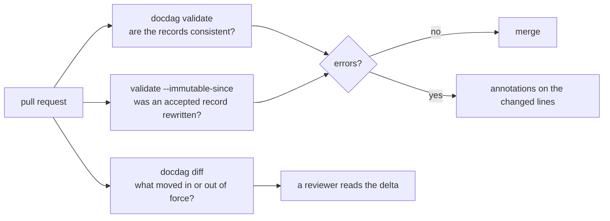
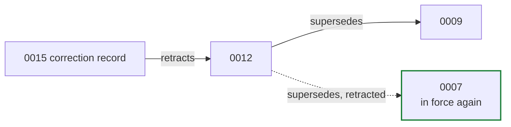
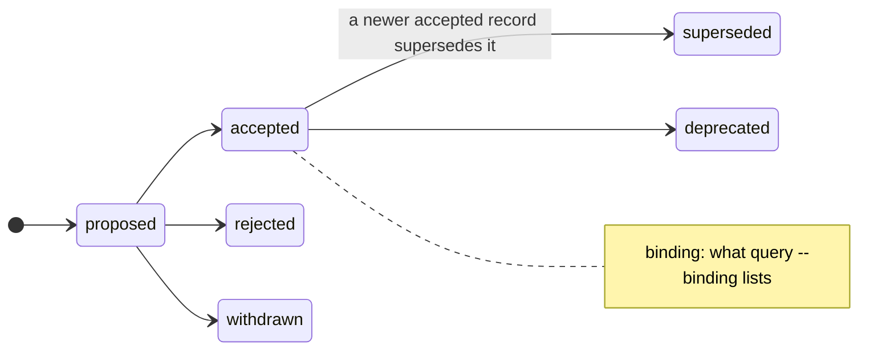
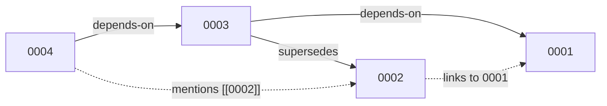

# DocDag

[](https://github.com/Kaikei-e/DocDag/actions/workflows/ci.yml)
[](https://github.com/Kaikei-e/DocDag/releases/latest)
[](https://pkg.go.dev/github.com/Kaikei-e/DocDag)
[](LICENSE)

**DocDag checks your decision records the way a compiler checks code.** It reads a directory of
Markdown documents with YAML frontmatter, builds the graph they declare — what supersedes what, what
depends on what — and fails the build where the records contradict each other.

Decision records rot in ways a prose review does not catch:

- a decision was replaced, and its status still says `accepted`
- `supersedes: 0042` points at a file nobody wrote
- two decisions supersede each other in a cycle
- an accepted record was quietly edited months later
- nobody can say which decisions are in force today without reading all of them
- a coding agent reads a replaced decision and follows it, because nothing in the file says it is
  out of force

Each of these is a property of a graph, so a deterministic check can enforce it.



DocDag is one static binary, needs no configuration for a conventional ADR directory, and runs in
one CI line. It is tested on real corpora as well as fixtures: it checks the decision records of
[Alt](https://github.com/Kaikei-e/Alt) (over 1,000 ADRs),
[PlectoProxy](https://github.com/Kaikei-e/PlectoProxy) and
[MatrixWhale](https://github.com/Kaikei-e/MatrixWhale), and this repository's CI checks
[its own](docs/ADR/).



**Contents:** [Install](#install) · [Five-minute tour](#five-minute-tour) ·
[Command cheat sheet](#command-cheat-sheet) · [CI](#put-it-in-ci) ·
[Correcting an accepted record](#when-an-accepted-record-is-wrong) ·
[What it checks](#what-it-checks) · [Configuration](#configuration) ·
[Coding agents](#for-coding-agents) · [Specifications](#beyond-adrs-a-specification-as-a-graph) ·
[Existing records](#works-with-the-records-you-already-have) · [How it works](#how-it-works) ·
[Status and support](#status-and-support) · [Documentation](#documentation)

## Install

With Go:

```sh
go install github.com/Kaikei-e/DocDag/cmd/docdag@v0.8.0
```

Without Go, on Linux or macOS — download the release binary and verify it against the release's
checksums:

```sh
VERSION=0.8.0
OS=$(uname -s | tr '[:upper:]' '[:lower:]')
ARCH=$(uname -m | sed 's/x86_64/amd64/; s/aarch64/arm64/')
curl -fsSLO "https://github.com/Kaikei-e/DocDag/releases/download/v${VERSION}/docdag_${VERSION}_${OS}_${ARCH}.tar.gz"
curl -fsSLO "https://github.com/Kaikei-e/DocDag/releases/download/v${VERSION}/checksums.txt"
sha256sum --ignore-missing -c checksums.txt    # macOS: shasum -a 256 --ignore-missing -c checksums.txt
tar -xzf "docdag_${VERSION}_${OS}_${ARCH}.tar.gz" docdag
sudo mv docdag /usr/local/bin/
```

Windows archives are on the [Releases page](https://github.com/Kaikei-e/DocDag/releases). Check the
install:

```sh
docdag --version
```

Already have a directory of ADRs? Run this from the repository root:

```sh
docdag validate
```

DocDag looks in `docs/adr`, `doc/adr`, `docs/decisions`, `docs/ADR` and `adr`, takes the first that
holds files named `NNNN.md` or `NNNN-kebab-title.md`, and applies the built-in `adr` preset. Point
it somewhere else with `docdag --dir path/to/records validate`.

If your records keep `status` in YAML frontmatter, as MADR 3 and 4 do, that is all the setup there
is. If they keep it in the body instead — adr-tools and other Nygard-style records use a
`## Status` section — read [Records without frontmatter](#records-without-frontmatter) first:
DocDag passes such a corpus with warnings but cannot see its edges.

## Five-minute tour

No ADRs at hand? Each block below can be pasted into a terminal as it is. The tour builds a
two-record sandbox, breaks it, fixes it and asks it questions.

**1. Make two records.** The second replaces the first, but nobody updated the first one's status.

```sh
cd "$(mktemp -d)" && mkdir -p docs/adr

cat > docs/adr/0001-use-postgresql.md <<'EOF'
---
title: Use PostgreSQL
status: accepted
date: 2026-01-10
---

# Use PostgreSQL

## Decision

Orders are stored in PostgreSQL.
EOF

cat > docs/adr/0002-use-sqlite-at-the-edge.md <<'EOF'
---
title: Use SQLite at the edge
status: accepted
date: 2026-03-02
supersedes: ["0001"]
---

# Use SQLite at the edge

## Decision

Edge nodes store orders in SQLite, replacing [[0001]].
EOF
```



**2. Validate.** DocDag reports the contradiction, names the line and says how to fix it.

```sh
docdag validate
```

```text
docs/adr/0001-use-postgresql.md:3: ERROR status_drift 0001: has inbound supersedes but status is not superseded
  fix: set status: superseded in docs/adr/0001-use-postgresql.md
```

Every finding has this shape — `<path>:<line>: <SEVERITY> <rule> <id>: <detail>` — and the exit code
is 1, which is what stops a CI job.

**3. Apply the fix and validate again.**

```sh
sed -i.bak 's/^status: accepted/status: superseded/' docs/adr/0001-use-postgresql.md
rm docs/adr/0001-use-postgresql.md.bak
docdag validate
```

```text
OK: 2 docs, 1 typed edges, no cycles
```

**4. Ask the graph.**

```sh
docdag resolve 0001        # what replaced this decision?
docdag query --binding     # what is in force right now?
docdag context 0001        # the record, what it resolves to, and the decision text of each
```

```text
0002
0002
ref
  0001  Use PostgreSQL  [superseded]  docs/adr/0001-use-postgresql.md
    Orders are stored in PostgreSQL.

resolves to (0001 is superseded)
  0002  Use SQLite at the edge  [accepted]  docs/adr/0002-use-sqlite-at-the-edge.md
    Edge nodes store orders in SQLite, replacing [[0001]].
```

**5. Write the next decision.** `docdag new` creates the record and marks the one it replaces,
touching nothing else in that file. Commit first, so that step 6 has something to compare with.

```sh
git init -q && git add -A
git -c user.name=demo -c user.email=demo@example.com commit -qm "decisions so far"

docdag new "Move orders to DynamoDB" --supersedes 0002
```

```text
docs/adr/0003-move-orders-to-dynamodb.md
```

**6. See what the change does to the graph.** This is what a reviewer wants from a pull request.

```sh
docdag diff HEAD
```

```text
+ supersedes 0003 -> 0002
~ status     0002: accepted -> superseded
+ document   0003 [proposed]
binding: 1 -> 0 (-1)
```

The last line says a decision went out of force and nothing took its place: `0003` is still
`proposed`. Accept it and the number comes back.

```sh
sed -i.bak 's/^status: proposed/status: accepted/' docs/adr/0003-move-orders-to-dynamodb.md
rm docs/adr/0003-move-orders-to-dynamodb.md.bak
docdag diff HEAD | tail -1
docdag resolve 0001
```

```text
binding: 1 -> 1 (0)
0003
```

**7. Draw it.** `docdag export` prints Mermaid, which GitHub renders in a Markdown file as it is.

```sh
docdag export
```



## Command cheat sheet

| I want to know… | Run |
| --- | --- |
| Are the records consistent? | `docdag validate` |
| What is in force today? | `docdag query --binding` |
| What replaced decision 12? | `docdag resolve 0012` |
| What does decision 12 build on? | `docdag query 0012 --edge depends-on` |
| What would break if decision 12 changed? | `docdag query 0012 --ancestors --edge depends-on` |
| Everything about decision 12, briefly | `docdag context 0012 --budget 400` |
| Orient a coding agent on this corpus | `docdag prime` |
| What does this branch change? | `docdag diff origin/main` |
| What can this one edit break? | `docdag validate --touching docs/adr/0012-some-title.md` |
| What would `new` write? | `docdag new "Some title" --supersedes 0012 --dry-run` |
| Are my rules themselves sound? | `docdag lint` |
| How big and how connected is the corpus? | `docdag stats` |

Recipes for scripts — every reading command takes `--format json`:

```sh
# One line per finding, for a report or a dashboard
docdag validate --format json \
  | jq -r '.findings[] | "\(.severity)\t\(.rule)\t\(.id)\t\(.location.path):\(.location.line)"'

# The decisions in force, with their titles
docdag query --binding --fields id,title

# The same as JSON
docdag query --binding --format json | jq -r '.[] | "\(.id)\t\(.title)"'

# Only the supersession chains, written to a file
docdag export --connected --edge supersedes --out supersedes.mmd

# An SVG, with Graphviz installed
docdag export --format dot | dot -Tsvg > decisions.svg

# The corpus as it was at a tag
docdag query --binding --at v1.0.0
```

[docs/commands.md](docs/commands.md) documents every command, flag, exit code and output shape.

## Put it in CI



Save this as `.github/workflows/decisions.yml`. The composite action downloads the release binary,
verifies it against the release's `checksums.txt`, and needs no Go toolchain.

```yaml
name: decisions
on:
  pull_request:
  push:
    branches: [main]

jobs:
  docdag:
    runs-on: ubuntu-latest
    steps:
      - uses: actions/checkout@v4
        with:
          fetch-depth: 0   # --immutable-since and diff read history

      - name: Records are consistent, and accepted ones were not rewritten
        uses: Kaikei-e/DocDag@v0.8.0
        with:
          version: v0.8.0
          args: validate --format github --immutable-since origin/${{ github.base_ref || github.event.repository.default_branch }}

      - name: Show what the change does to the graph
        if: github.event_name == 'pull_request'
        uses: Kaikei-e/DocDag@v0.8.0
        with:
          version: v0.8.0
          args: diff origin/${{ github.base_ref }} --format github
```

What each part buys you:

- **`validate`** exits 1 if any finding is an error, and exits 3 if the check could not actually
  run — no documents found, a misspelled key in `docdag.yaml`, a directory that does not exist. A
  job that checked nothing does not pass.
- **`--immutable-since`** freezes accepted records: a pull request may change an accepted record's
  `status` and append to it, and nothing else.
- **`diff`** annotates each added or removed edge and each status change, and ends with the
  `binding:` line. A change that takes decisions out of force says so in a number, which a
  900-file diff does not.

The simplest possible gate is two lines in an existing job:

```yaml
      - uses: actions/checkout@v4
      - uses: Kaikei-e/DocDag@v0.8.0
```

Prefer to catch it before the push? Add the [pre-commit](https://pre-commit.com) hooks:

```yaml
repos:
  - repo: https://github.com/Kaikei-e/DocDag
    rev: v0.8.0
    hooks:
      - id: docdag-validate      # any .md or docdag.yaml edit: the invariants
      - id: docdag-lint          # a docdag.yaml edit: the rules themselves
```

[docs/ci.md](docs/ci.md) covers SHA pinning, `reviewdog` output, step summaries and scheduled runs.

## When an accepted record is wrong

Freezing accepted records raises a question: what if a wrong edge is already in one? Suppose `0012`
lists `0007` under `supersedes` by mistake. `0007` is still the rule, but it has dropped out of
`query --binding`, and the gate forbids editing `0012`. The correction is a record of its own:

```sh
cat > docs/adr/0015-0012-did-not-replace-0007.md <<'EOF'
---
title: 0012 did not replace 0007
status: accepted
date: 2026-11-15
retracts:
  - from: "0012"
    edge: supersedes
    to: "0007"
---

# 0012 did not replace 0007

## Decision

The supersedes entry for [[0007]] in [[0012]] was added by mistake. 0007 remains in force.
EOF
```



Once `0015` is accepted, the edge is void everywhere — `validate`, `resolve`, `query` and `export`
all read the corrected graph — and `0007` can go back to `status: accepted`. Nothing was rewritten.
`docdag context 0007` shows the retraction, and withdrawing `0015` undoes it. A retraction that
names an edge that does not exist is itself a finding (`invalid_retraction`), so a typo cannot
silently do nothing.

## What it checks

| Area | Findings |
| --- | --- |
| Files and frontmatter | `invalid_frontmatter`, `missing_frontmatter`, `id_collision`, `unknown_status`, `unmanaged_file` |
| Edges | `dangling_ref`, `invalid_ref`, `empty_edge`, `cycle`, `cardinality`, `inverse_mismatch`, `stale_target`, `invalid_retraction` |
| Status against the graph | `status_drift` (replaced, but not marked superseded), `superseded_orphan` (marked superseded, but nothing replaced it) |
| History | `immutable_violation`, under `--immutable-since` |
| Opt-in | required body `sections:`, declared `fields:` (vocabularies, required keys, lists), `require_mention` on an edge, dangling body links, kinds with their own identifier shapes, in-force periods |

The `adr` preset knows six statuses. DocDag does not police how a record moves between them; it
checks that the status agrees with the edges.



[docs/checks.md](docs/checks.md) gives every finding its severity, its trigger and its remedy.

Rules are configuration, so they can be wrong too. `docdag lint` checks the rules rather than the
documents: a rule that can never fire, one that fires on everything, two that say the same thing,
and — with `--corpus` or `--fixtures` — a rule your records have never triggered.

## Configuration

`docdag.yaml` is optional. Add one at the repository root when the defaults stop being enough;
everything in it is opt-in. This one is a reasonable start for a MADR repository:

```yaml
preset: adr
dir: docs/decisions

fields:
  date: {required: true}
  tags: {type: list, min_items: 1}

edges:
  - {name: supersedes, key: supersedes, acyclic: true, direction: forward, require_mention: warn}
  - {name: depends-on, key: depends-on, acyclic: true, direction: forward}

sections:
  required: ["Context and Problem Statement", "Decision Outcome"]

references:
  dangling: error
```

It asks for a date on every record, at least one tag where tags are written, the two MADR headings,
no broken links in bodies, and a warning when a record claims to supersede another without ever
mentioning it. After editing the file, check the rules and the corpus:

```sh
docdag lint && docdag validate
```

[docs/configuration.md](docs/configuration.md) is the full reference, including custom edges,
custom rules and both presets printed in full.

## For coding agents

An agent that reads forty ADR files to answer "what is in force?" spends its context on the wrong
thing. One command replaces the fan-out:

```sh
# Orient on corpus health, dirs/kinds, declared fields and tailored commands
docdag prime

# A record (by ID or file path), what it resolves to and its neighbourhood, capped at 400 tokens
docdag context 0012 --budget 400 --format md

# The decisions in force that touch one service (needs affected_services declared under fields:)
docdag query --binding --where affected_services=contains:billing --fields id,title

# After editing a record: only what that edit can break
docdag validate --touching docs/adr/0012-some-title.md
```

This repository ships as a dual-native plugin for both **Claude Code** and **Antigravity (`agy`)**.
It installs a shared skill, a `SessionStart` hook running `docdag prime`, non-blocking
read guidance on managed paths, and edit-time validation (`validate --touching` / `lint`):

```sh
# Claude Code
claude plugin marketplace add Kaikei-e/DocDag
claude plugin install docdag@docdag

# Antigravity CLI (agy)
agy plugin install https://github.com/Kaikei-e/DocDag
```

Inside a Claude Code session the two steps are `/plugin marketplace add Kaikei-e/DocDag` and then
`/plugin install docdag@docdag`, entered as separate prompts. [docs/agents.md](docs/agents.md)
covers `prime`, `context`, `--fields`, `--where`, `--touching`, and both plugin integrations.

Any other agent that can run a shell gets the same answers. A few lines in `AGENTS.md` (or
`CLAUDE.md`) are enough to make it ask the graph instead of reading the directory:

```markdown
## Architecture decisions

- Decision records live in `docs/adr` and are checked by DocDag.
- Before changing a design, run `docdag query --binding --fields id,title` to list the decisions
  in force, then `docdag context <id> --budget 400 --format md` for the ones you touch.
- Treat binding decisions as rules. A superseded record is history, not guidance.
- After editing a record, run `docdag validate --touching <file>` and fix what it reports.
```

## Beyond ADRs: a specification as a graph

The second preset, `spec`, treats a normative standard the same way: clauses, the conformance tests
that enforce them and the deviations recorded against them, each kind in its own directory with its
own identifier shape. One line adopts it:

```sh
echo "preset: spec" > docdag.yaml
```

```console
$ docdag validate
spec/clauses/UZ-V-002.md:4: ERROR orphan_must UZ-V-002: is MUST or MUST_NOT and accepted but nothing enforces it
as of 2026-09-02

$ docdag query --binding                      # what is in force, and at what strength
UZ-V-001	MUST
UZ-V-002	MUST
UZ-V-003	SHOULD

$ docdag query --binding --as-of 2027-06-01   # UZ-V-003 runs out on 2027-01-01
UZ-V-001	MUST
UZ-V-002	MUST
```

A `MUST` that no test enforces is a finding. Clauses can carry an in-force period, so "what is
binding" is a question about a day: `--as-of <day>` picks the day and `--at <rev>` picks the
revision the documents are read from.

## Works with the records you already have

- **A MADR 3 or 4 repository validates as it is.** Filenames `NNNN-kebab-title.md` and bare
  `NNNN.md` are recognized, 3 to 6 digits. Frontmatter keys DocDag does not know are ignored, so
  another tool's fields are safe.
- **`status: superseded by 0003` is understood.** It yields the same `supersedes` edge as declaring
  it in frontmatter, with a warning that suggests the structured form.
- **References are forgiving.** `339`, `ADR-339`, `000339` and `0339-use-postgres.md` all name the
  same record, so renaming a file's title does not break anything that points at it.
- **Body links cannot fail a build** unless `references.dangling` asks for that.

### Records without frontmatter

DocDag reads status and typed edges from YAML frontmatter only. A record without a `---` block —
the layout adr-tools writes, with the status under `## Status`, or MADR 2's `* Status:` line — is
still counted, but it is reported as a `missing_frontmatter` warning and contributes no edges. On
such a corpus `validate` passes and `query --binding` lists nothing.

Add a block at the top of each record. The body can stay as it is:

```markdown
---
title: Use MADR
status: accepted
supersedes: ["0001"]
---

# 2. Use MADR

Date: 2026-02-01

## Status

Accepted
```

To keep a gate from passing on records it cannot read, turn the warning into an error in
`docdag.yaml`:

```yaml
structural: {missing_frontmatter: error}
```

## How it works

DocDag keeps two layers apart. The **constraint layer** is the typed edges written in frontmatter
(`supersedes:`, `depends-on:`, and any you declare). Only these carry invariants. The **reference
layer** is the untyped `[[wikilinks]]` and relative Markdown links in bodies; it is reported by
`stats` and `--include-refs` and never constrains anything by default.



Solid arrows are typed edges and are checked. Dotted arrows are body links and are only reported.

Status is read against that graph rather than trusted on its own. A record is *binding* when its
status is `accepted`, it is in force, and nothing `accepted` and in force (or `superseded`)
supersedes it, and a status the edges contradict is a finding, not a matter of opinion.

The rule language is deliberately small, so that every configuration can be checked without a
solver: no expression language, conditions that look at most one hop away, and path constraints of
one or two steps. The binary is the Go standard library plus `github.com/goccy/go-yaml`. The
[decision records](docs/ADR/) explain each of these choices; they are validated by DocDag in this
repository's own CI.

## Go packages

The `config`, `model` and `lint` packages are public, for a program that wants to build a
configuration, validate it and write `docdag.yaml` without shelling out:

```sh
go get github.com/Kaikei-e/DocDag@v0.8.0
```

```go
cfg := config.SpecPreset()
// … add kinds, edges, rules …
if err := cfg.Validate(); err != nil {
    return err
}
out, err := yaml.Marshal(cfg)
```

The field names and YAML tags of `config.Config` are the contract;
[ADR 0006](docs/ADR/0006-public-config-yaml-roundtrip-and-append-only.md) says what is stable.

## Documentation

- [docs/commands.md](docs/commands.md) — every command (`validate`, `lint`, `resolve`, `query`,
  `context`, `prime`, `export`, `stats`, `diff`, `new`), its flags, exit codes and output formats.
- [docs/configuration.md](docs/configuration.md) — the `docdag.yaml` reference and both presets in
  full.
- [docs/checks.md](docs/checks.md) — one entry per finding: what triggers it and what clears it.
- [docs/ci.md](docs/ci.md) — the action, annotations, append-only history, correcting a frozen
  record, scheduled expiry runs and pre-commit hooks.
- [docs/agents.md](docs/agents.md) — `context`, `--fields`, `--where`, `--touching` and the Claude
  Code plugin.
- [docs/ADR/](docs/ADR/) — the decision records behind the design.
- [CHANGELOG.md](CHANGELOG.md) — what each release changed, with migration steps for the breaking
  ones (v0.5.0 and v0.7.0).
- [Introduction in Japanese (Zenn)](https://zenn.dev/e_kaikei/articles/e8285ce4006eda) — why
  DocDag exists, and what it found in a corpus of over 1,000 ADRs.

## Status and support

DocDag is pre-1.0 and in daily use. Until 1.0, a minor release may break things; every breaking
change is marked in [CHANGELOG.md](CHANGELOG.md), with migration steps. Pin a version in CI
(`Kaikei-e/DocDag@v0.7.0`, `go install …@v0.7.0`) and upgrade on purpose.

If DocDag misreads your records, please open an issue. The most useful report is a minimal corpus:
two or three records, the command you ran, and what you expected. Issues are read once a week.

## License

Apache License 2.0. See [LICENSE](LICENSE).
